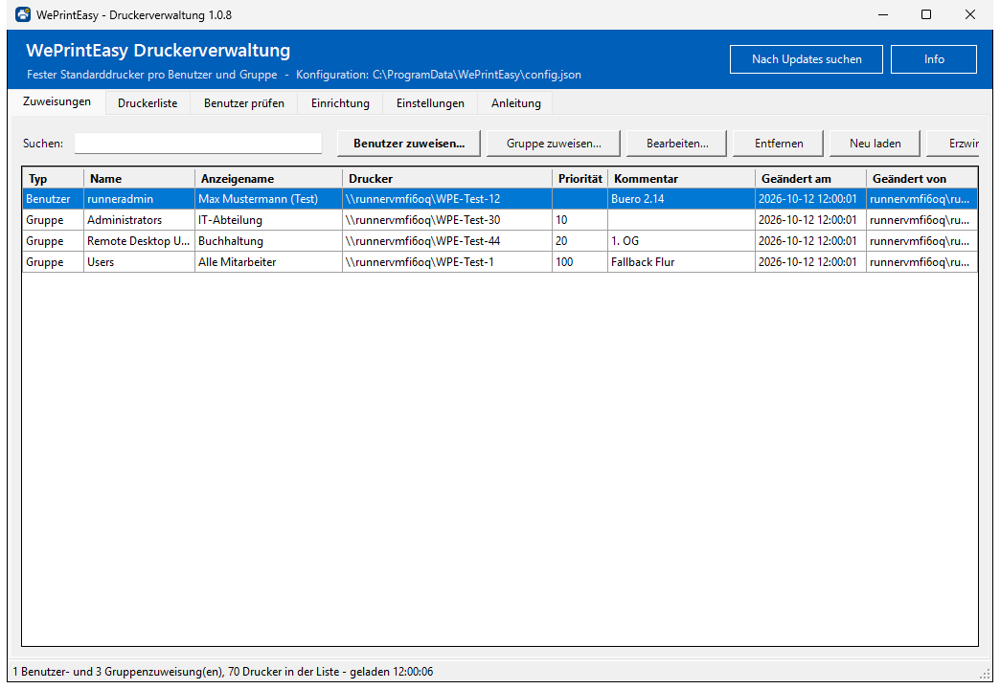
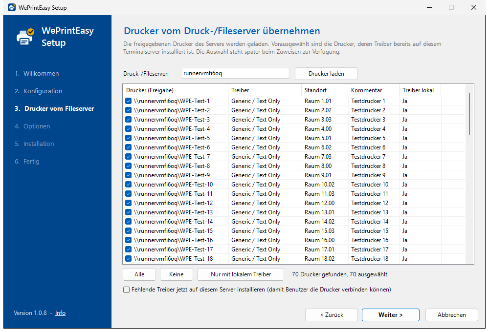
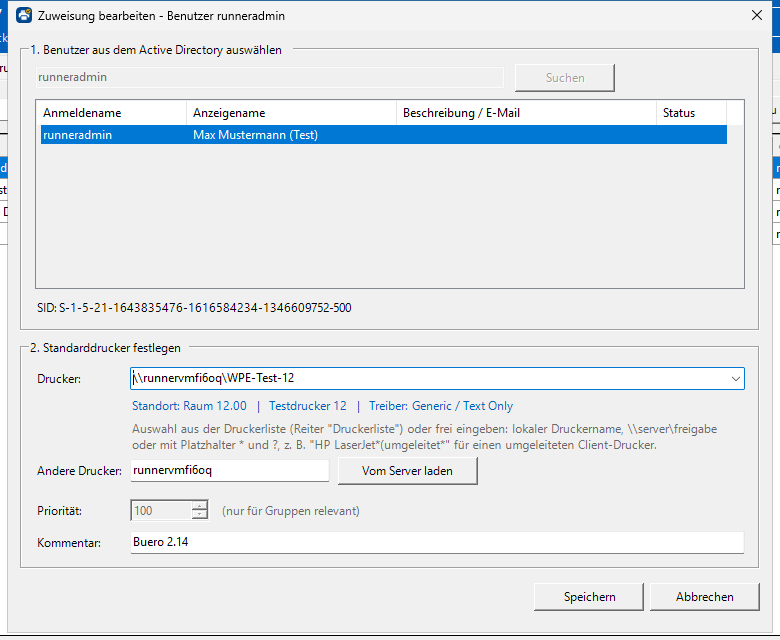
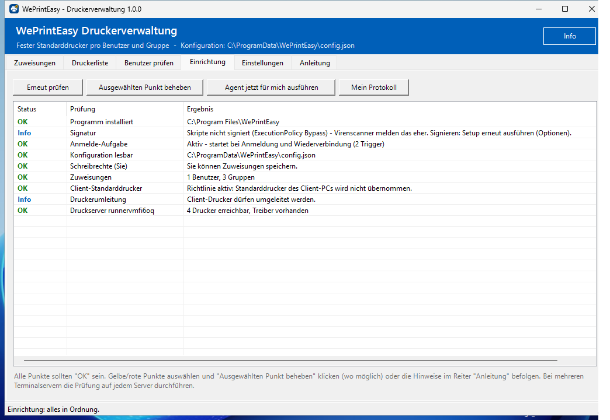
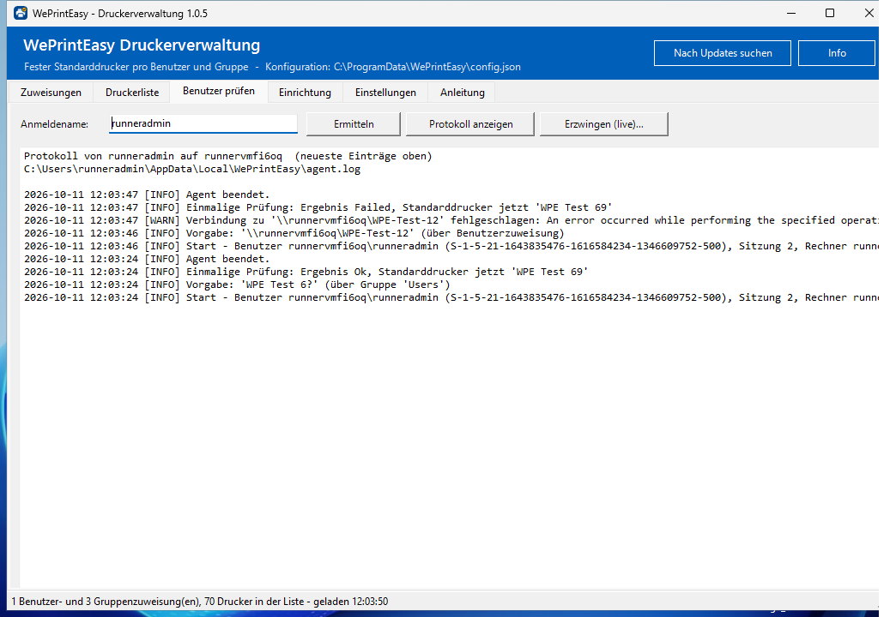
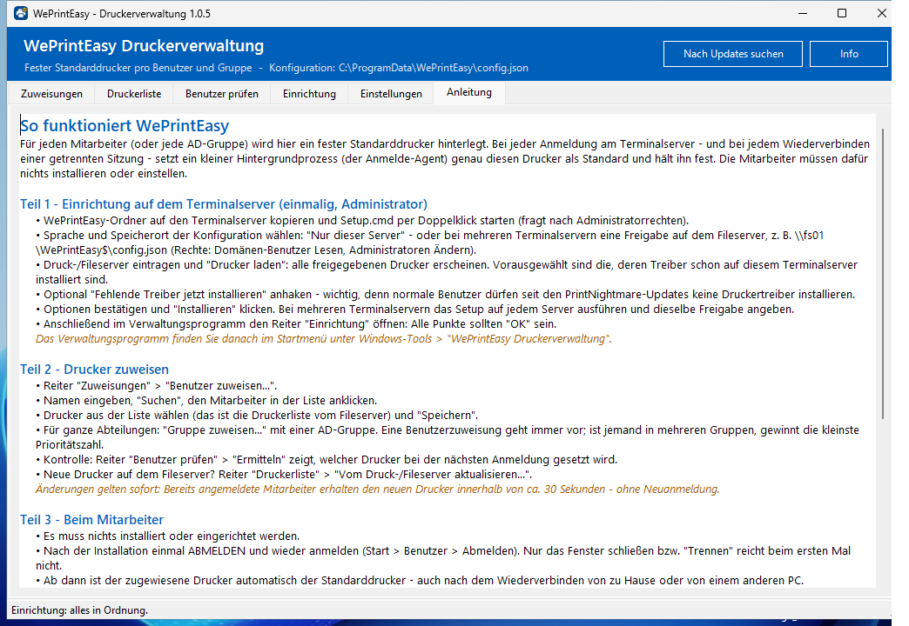
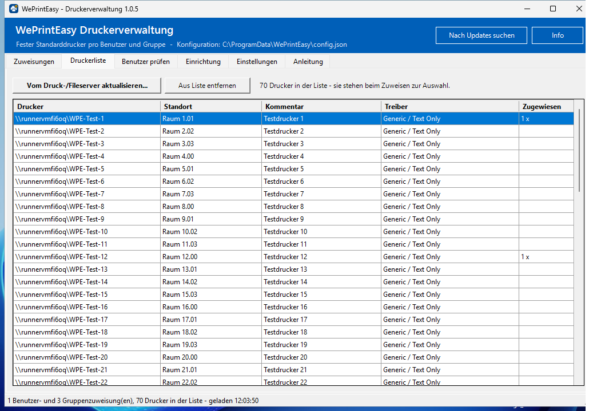

<div align="center">


# WePrintEasy

**Fester Standarddrucker pro AD-Benutzer und -Gruppe auf dem Terminalserver.**<br>
Gesetzt bei jeder Anmeldung – und auf Wunsch festgehalten während der ganzen Sitzung.

[](https://github.com/LeonMTN05/WePrintEasy/actions/workflows/tests.yml)
[](https://scorecard.dev/viewer/?uri=github.com/LeonMTN05/WePrintEasy)
[](https://github.com/LeonMTN05/WePrintEasy)
[](LICENSE)
<br>
[](#-systemvoraussetzungen)
[](#-systemvoraussetzungen)
[](#-systemvoraussetzungen)
[](#-sprache)

[English](README.md) · **Deutsch**

[**Schnellstart**](#-schnellstart) · [Funktionen](#-funktionen) · [Bildschirmfotos](#-bildschirmfotos) · [Bedienung](#-bedienung) · [Fehlersuche](#-fehlersuche) · [Website](https://weprinteasy.de)



</div>

---

Auf Terminalservern (RD-Sitzungshosts) springt der Standarddrucker der Benutzer gerne um: Windows
nimmt den zuletzt benutzten Drucker, die RDP-Umleitung bringt den Drucker des eigenen PCs mit,
Programme verstellen ihn nebenbei. **WePrintEasy** legt pro AD-Benutzer oder AD-Gruppe einen festen
Standarddrucker fest – und sorgt dafür, dass er es auch bleibt.

## ✨ Funktionen

- 🎯 **Fester Standarddrucker** pro AD-Benutzer oder AD-Gruppe – inkl. Prioritäten und verschachtelter Gruppen
- 🔁 **Wird gesetzt und festgehalten** – bei Anmeldung, Wiederverbindung und auf Wunsch während der ganzen Sitzung
- 🖨️ **Druckerliste vom Fileserver** – alle Freigaben mit einem Klick laden, fehlende Treiber gleich mitinstallieren
- 🧙 **Grafischer Setup-Assistent** – Installation in ca. 2 Minuten, Update per Doppelklick
- ⚡ **„Erzwingen (live)“** – setzt den Drucker sofort in der Sitzung eines Benutzers und zeigt jeden Schritt
- 🖱️ **Optional: Benutzer wählen selbst** – Symbol im Infobereich, die Wahl ersetzt ihre Zuweisung und ist in der Verwaltung sichtbar
- 🩺 **Systemprüfung mit Ampel** – findet Konfigurationsfehler und behebt sie auf Knopfdruck
- 🏢 **RDS-Farm-tauglich** – eine zentrale Konfiguration für beliebig viele Terminalserver
- 🔏 **Optional signiert** (Authenticode, `AllSigned`) – weniger Fehlalarme von Virenscannern
- 🌐 **Englisch und Deutsch** – Oberfläche und Protokolle, umschaltbar in den Einstellungen
- 📦 **Keine Abhängigkeiten** – nur die mitgelieferte Windows PowerShell 5.1, kein RSAT, keine AD-Schemaerweiterung

## 📸 Bildschirmfotos

<table>
  <tr>
    <td width="50%"><b>Setup-Assistent: Drucker vom Fileserver</b><br></td>
    <td width="50%"><b>Zuweisung bearbeiten</b><br></td>
  </tr>
  <tr>
    <td><b>Einrichtung (Systemprüfung)</b><br></td>
    <td><b>Protokoll eines Benutzers</b><br></td>
  </tr>
  <tr>
    <td><b>Anleitung im Programm</b><br></td>
    <td><b>Druckerliste</b><br></td>
  </tr>
</table>

<sub>Aufgenommen im automatischen Test auf Windows Server 2025 (70 Testdrucker als simulierter Fileserver). Alle Bilder: <a href="docs/screenshots"><code>docs/screenshots</code></a></sub>

## 🤔 Warum ändert sich der Standarddrucker überhaupt?

| Ursache | Was WePrintEasy dagegen tut |
|---|---|
| **„Windows verwaltet Standarddrucker“** – Windows setzt automatisch den zuletzt benutzten Drucker als Standard | Agent schaltet die Option pro Benutzer ab (`LegacyDefaultPrinterMode = 1`) |
| **RDP-Druckerumleitung** – der Standarddrucker des Client-PCs wird nach der Anmeldung (zeitverzögert!) zum Standarddrucker der Sitzung | Agent prüft nach der Anmeldung 2 Minuten lang alle 3 Sekunden und setzt zurück; optional zusätzlich Richtlinie `fForceClientLptDef = 0` |
| Programme/Benutzer ändern den Standarddrucker während der Sitzung | Optionale Überwachung während der gesamten Sitzung (Standard: alle 30 Sekunden) |
| Netzwerkdrucker ist nach der Anmeldung (noch) nicht verbunden | Agent verbindet `\\server\freigabe` automatisch |

## 📋 Systemvoraussetzungen

| | |
|---|---|
| **Betriebssystem** | Windows Server 2025, 2022 oder 2019 mit Remotedesktop-Sitzungshost |
| **Laufzeit** | Windows PowerShell 5.1 (bei Windows dabei) |
| **Active Directory** | Server ist Domänenmitglied – kein RSAT, keine Schemaerweiterung |
| **Rechte** | Administrator für die Installation; Benutzer brauchen nur Leserechte auf die Konfiguration (mit [Druckerwahl durch Benutzer](#️-druckerwahl-durch-benutzer): Anlegen im Ordner `choices`) |

## 🚀 Schnellstart

1. Repository als ZIP herunterladen ([Download](https://github.com/LeonMTN05/WePrintEasy/archive/HEAD.zip) oder [Website](https://weprinteasy.de)) und auf dem Terminalserver entpacken.
2. **`Setup.cmd`** doppelklicken (fragt nach Administratorrechten).
3. **Sprache** wählen – Englisch ist vorausgewählt, bei einem Update die bisherige Sprache.
4. Dem Assistenten folgen, fertig. Danach im Startmenü unter **Windows-Tools → WePrintEasy Druckerverwaltung** Drucker zuweisen.

> [!TIP]
> Bei mehreren Terminalservern das Setup auf jedem Server ausführen und denselben zentralen
> Konfigurationspfad angeben, z. B. `\\fs01\WePrintEasy$\config.json` – siehe [RDS-Farm](#mehrere-sitzungshosts-rds-farm).

<details>
<summary><b>Die Schritte des Setup-Assistenten im Detail</b></summary>
<br>

| Schritt | Inhalt |
|---|---|
| Willkommen | Überblick, erkennt eine vorhandene Installation (Zuweisungen bleiben erhalten) |
| Konfiguration | „Nur dieser Server“ oder zentral auf dem Fileserver (`\\fs01\WePrintEasy$\config.json`) – mit Schreibtest |
| Drucker vom Fileserver | Druck-/Fileserver eintragen → **Drucker laden**: alle freigegebenen Drucker (z. B. 70) erscheinen mit Treiber, Standort und Kommentar. **Vorausgewählt sind die Drucker, deren Treiber schon lokal auf dem Terminalserver installiert ist.** Schaltflächen *Alle / Keine / Nur mit lokalem Treiber*; optional *Fehlende Treiber jetzt installieren* |
| Optionen | RDS-Richtlinie, Überwachung während der Sitzung, „Windows verwaltet Standarddrucker“ aus, Netzwerkdrucker verbinden, Verknüpfung, Editor-Gruppe, Signierung der Skripte (siehe [Codesignatur](#-codesignatur-virenscanner)) |
| Installation | Zusammenfassung → **Installieren** mit Live-Protokoll → Fertig (öffnet auf Wunsch die Druckerverwaltung) |

</details>

### 📦 Windows-Installer (`WePrintEasy-Setup-<Version>.exe`)

Alternative zum ZIP: eine einzelne `.exe` mit Eintrag unter **Apps / Programme und Features**.

- **Neuinstallation:** kopiert das Installationspaket nach `C:\Program Files\WePrintEasy\Setup` und startet den Setup-Assistenten in der Sprache des Installers.
- **Vorhandene Installation** (auch aus dem ZIP): Update mit allen Einstellungen wie `Update.cmd`; auf Wunsch anschließend der Setup-Assistent.
- **Deinstallation** über *Apps* – fragt, ob auch die lokale Konfiguration gelöscht werden soll.

```powershell
# Unbeaufsichtigt (Rückgabewert 0 = erfolgreich, 10 = fehlgeschlagen, Protokoll: C:\Program Files\WePrintEasy\Setup\WePrintEasy-Setup.log)
WePrintEasy-Setup-1.0.10.exe /VERYSILENT /SUPPRESSMSGBOXES /NORESTART /LANG=de /INSTALLARGS="-PrintServer fs01 -DisableClientDefaultPrinter"
& 'C:\Program Files\WePrintEasy\unins000.exe' /VERYSILENT [/REMOVECONFIG]
```

`/INSTALLARGS` gilt nur für Neuinstallationen und enthält Parameter von [`Install-WePrintEasy.ps1`](#️-installation-per-kommandozeile)
(Werte in einfachen Anführungszeichen). Selbst bauen: [Inno Setup 6](https://jrsoftware.org/isinfo.php) installieren
(`winget install --id JRSoftware.InnoSetup -e`), dann `.\tools\Build-Installer.ps1` → `dist\`.

Für den **Microsoft Store** (Pakettyp EXE) gelten dieselben stillen Parameter: `/VERYSILENT /SUPPRESSMSGBOXES /NORESTART`.
Ein neues Setup ersetzt die vorhandene Version (gleiche App-ID, gleicher Programmordner) und schließt vorher offene Druckerverwaltungen.

### 🔔 Update-Prüfung

Die Druckerverwaltung fragt beim Start im Hintergrund `https://dl.weprinteasy.com/latest.json` ab – höchstens einmal am Tag,
mit 10 Sekunden Timeout; ohne Internet läuft sie normal weiter. Gibt es eine neuere Version, erscheint **„Neue Version X verfügbar“**:
*Jetzt aktualisieren* lädt das Setup in einen Temp-Ordner, prüft seine SHA-256-Prüfsumme, startet es und beendet die Verwaltung.
Manuell: Knopf **Nach Updates suchen** im Kopfbereich.

Abschalten für einen Server (die manuelle Prüfung bleibt möglich):

```powershell
Set-ItemProperty -Path 'HKLM:\SOFTWARE\WePrintEasy' -Name DisableUpdateCheck -Value 1 -Type DWord
```

## 🔄 Update

Neue Version entpacken (bzw. in den bisherigen Ordner kopieren) und **`Update.cmd`** doppelklicken
(fragt nach Administratorrechten). Der Updater spielt die Programmdateien neu ein und übernimmt
alle bisherigen Einstellungen: Konfigurationspfad, Zuweisungen, Druckerliste, Sprache, Signierung,
Editor-Gruppe, RDS-Richtlinie und Verknüpfung. Am Ende zeigt er die Systemprüfung an.

> [!NOTE]
> Agenten, die in Benutzersitzungen bereits laufen, startet das Update mit der neuen Version neu – auch in getrennten Sitzungen.
> Installationen aus der Zeit vor der Sprachauswahl bleiben deutsch.
> Für automatisierte Updates: `.\Update-WePrintEasy.ps1 -NoPause`

## ⌨️ Installation per Kommandozeile

Alternative zum Setup-Assistenten, z. B. für automatisierte Installationen. PowerShell
**als Administrator** öffnen und im entpackten Ordner ausführen:

```powershell
Set-ExecutionPolicy -Scope Process Bypass
.\Install-WePrintEasy.ps1 -PrintServer fs01 -DisableClientDefaultPrinter
```

Das war's. Die Installation

- kopiert die Programmdateien nach `C:\Program Files\WePrintEasy`,
- legt die Konfiguration `C:\ProgramData\WePrintEasy\config.json` an
  (Benutzer dürfen nur **lesen**, Administratoren ändern),
- übernimmt mit `-PrintServer` die freigegebenen Drucker des Fileservers in die Druckerliste
  (Standard: nur die mit lokal installiertem Treiber; `-ImportPrinters All` für alle,
  `-InstallMissingDrivers` installiert fehlende Treiber),
- registriert die geplante Aufgabe **`\WePrintEasy\WePrintEasy Agent`**
  (Trigger: Anmeldung und Wiederverbindung einer RDP-Sitzung, läuft als der jeweilige Benutzer, unsichtbar),
- legt unter **Windows-Tools** die Verknüpfung **„WePrintEasy Printer Management“** bzw. auf Deutsch
  **„WePrintEasy Druckerverwaltung“** an (mit App-Symbol),
- stellt mit `-Language en` (Standard) oder `-Language de` die Sprache ein,
- setzt mit `-DisableClientDefaultPrinter` die Richtlinie *„Standardclientdrucker nicht als
  Standarddrucker in einer Sitzung festlegen“* (alternativ [per GPO](#alternative-zur-installer-richtlinie-gpo)).

Das Skript kann für Updates einfach erneut ausgeführt werden – vorhandene Zuweisungen bleiben erhalten.

### Mehrere Sitzungshosts (RDS-Farm)

Damit alle Server dieselben Zuweisungen verwenden, die Konfiguration zentral ablegen:

1. Freigabe anlegen, z. B. `\\fs01\WePrintEasy$`
   - NTFS/Freigabe: **Domänen-Benutzer: Lesen**, Admins (bzw. eine Gruppe „Druckeradmins“): **Ändern**
2. Auf **jedem** Sitzungshost installieren:

   ```powershell
   .\Install-WePrintEasy.ps1 -ConfigPath '\\fs01\WePrintEasy$\config.json' -PrintServer fs01 -DisableClientDefaultPrinter
   ```

Bei Installation und Update trägt sich jeder Server mit seiner Version im Ordner `hosts` neben der
Konfiguration ein. Der Reiter **Einrichtung** zeigt dann auf jedem Server, wo in der Farm noch eine
ältere Version läuft (Server mit einer Version vor 1.0.6 erscheinen erst nach ihrem Update).

Bei lokaler Konfiguration kann mit `-EditorGroup 'FIRMA\Druckeradmins'` eine Gruppe
berechtigt werden, die Zuweisungen ohne Administratorrechte zu pflegen.

<details>
<summary><b>Alle Parameter des Installers</b></summary>
<br>

| Parameter | Bedeutung |
|---|---|
| `-ConfigPath` | Pfad der Konfigurationsdatei (lokal oder UNC). Standard: `C:\ProgramData\WePrintEasy\config.json` |
| `-PrintServer` | Druck-/Fileserver, dessen freigegebene Drucker in die Druckerliste übernommen werden |
| `-ImportPrinters` | `WithLocalDriver` (Standard), `All` oder `None` |
| `-PrinterListFile` | Textdatei mit `\\server\freigabe` je Zeile (statt `-ImportPrinters`) |
| `-InstallMissingDrivers` | Fehlende Treiber der übernommenen Drucker installieren |
| `-EditorGroup` | AD-Gruppe mit Schreibrecht auf die lokale Konfiguration |
| `-DisableClientDefaultPrinter` | RDS-Richtlinie setzen, damit der Client-Standarddrucker nicht übernommen wird |
| `-InstallPath` | Installationsordner (Standard: `C:\Program Files\WePrintEasy`) |
| `-NoShortcut` | Keine Verknüpfung unter Windows-Tools anlegen |
| `-SelfSignedCertificate` | Skripte mit einem selbstsignierten Zertifikat dieses Servers signieren (siehe unten) |
| `-SigningCertificateThumbprint` | Skripte mit einem vorhandenen Codesignatur-Zertifikat signieren (z. B. Firmen-CA) |
| `-TimestampServer` | Zeitstempeldienst für die Signatur, z. B. `http://timestamp.digicert.com` (Internetzugang nötig) |
| `-NoSigning` | Nicht signieren bzw. eine vorhandene Signierung abschalten |
| `-Language` | Sprache von Installer, Verwaltung und Agent-Protokoll: `en` (Standard) oder `de`. Ohne Angabe bleibt bei einem Update die bisherige Sprache |

</details>

### 🔏 Codesignatur (Virenscanner)

Ohne Signatur startet die Anmelde-Aufgabe den Agenten unsichtbar mit `-ExecutionPolicy Bypass`.
Manche Virenscanner (z. B. Panda) stufen dieses Muster als verdächtig ein. Mit Signatur werden
alle installierten Skripte per Authenticode signiert, und Aufgabe, Verknüpfung und
`WePrintEasy-Admin.cmd` starten mit **`-ExecutionPolicy AllSigned`**.

```powershell
# Selbstsigniert (ein Server, keine CA nötig)
.\Install-WePrintEasy.ps1 -SelfSignedCertificate

# Zertifikat der Firmen-CA (Vorlage „Codesignatur“, mit privatem Schlüssel im Speicher LocalMachine\My oder CurrentUser\My)
.\Install-WePrintEasy.ps1 -SigningCertificateThumbprint 'A1B2C3...' -TimestampServer 'http://timestamp.digicert.com'
```

- **Selbstsigniert:** Das Zertifikat `CN=WePrintEasy Codesignatur (<Server>)` ist 5 Jahre gültig,
  sein Schlüssel ist nicht exportierbar. Es wird nur auf diesem Server als vertrauenswürdig eingetragen
  (`LocalMachine\Root` und `LocalMachine\TrustedPublisher`). Bei einem Update ab 30 Tage vor Ablauf
  erneuert der Installer es automatisch. Die Deinstallation entfernt es wieder.
- **Firmen-CA:** Der Installer trägt das Zertifikat in `LocalMachine\TrustedPublisher` ein. Der CA
  muss der Server bereits vertrauen (in der Domäne üblich).
- Die Signierung bleibt bei Updates erhalten. Mit `-NoSigning` schaltet man sie ab.
- Schlägt die Signierung fehl, installiert der Installer mit einer Warnung unsigniert (`Bypass`).
  So bleibt der Agent lauffähig.

> [!IMPORTANT]
> Wenn man die installierten Skripte nachträglich ändert, wird ihre Signatur ungültig und der
> Agent startet nicht mehr. Danach den Installer erneut ausführen, er signiert neu. Der Reiter
> „Einrichtung“ zeigt den Zustand unter **Signatur** an.

> [!WARNING]
> Eine Signatur macht Fehlalarme seltener, schließt sie aber nicht aus. Hilft sie nicht, die Ordner
> `C:\Program Files\WePrintEasy` und `C:\ProgramData\WePrintEasy` im Virenscanner ausnehmen.
> `powershell.exe` selbst sollte man niemals ausnehmen.

## 💻 Bedienung

Start über **Windows-Tools → WePrintEasy Druckerverwaltung** (englisch: *WePrintEasy Printer Management*)
oder `C:\Program Files\WePrintEasy\WePrintEasy-Admin.cmd`. Fehlen Schreibrechte, bietet das Programm
an, sich als Administrator neu zu starten.

**Info** (Knopf oben rechts oder <kbd>F1</kbd>) zeigt Version, Projektseite, Systeminformationen und den
Haftungsausschluss. **Fehler auf GitHub melden…** öffnet ein vorausgefülltes Issue – die
Systeminformationen enthalten keine Rechner-, Benutzer-, Domänen- oder Servernamen.

| Reiter | Wofür |
|---|---|
| **Zuweisungen** | Benutzern und Gruppen ihren Drucker zuweisen, bearbeiten, entfernen, erzwingen |
| **Druckerliste** | Drucker, die beim Zuweisen zur Auswahl stehen – vom Druck-/Fileserver aktualisieren |
| **Benutzer prüfen** | Welcher Drucker wird gesetzt und warum? Protokoll des Agenten ansehen |
| **Einrichtung** | Systemprüfung mit Ampel, Probleme auf Knopfdruck beheben |
| **Einstellungen** | Anmeldephase, Überwachung, Druckserver, Sprache |
| **Anleitung** | Schritt-für-Schritt-Anleitung direkt im Programm |

<details>
<summary><b>Reiter „Zuweisungen“</b></summary>
<br>

- **Benutzer zuweisen…** – Benutzer im AD suchen (Name, Anmeldename oder E-Mail),
  auswählen, Drucker wählen, speichern.
- **Gruppe zuweisen…** – dasselbe für eine AD-Gruppe. Über die **Priorität** wird
  festgelegt, welche Gruppe gewinnt, wenn ein Benutzer in mehreren Gruppen ist
  (kleinste Zahl gewinnt). Verschachtelte Gruppen werden berücksichtigt.
- **Bearbeiten…** (oder Doppelklick), **Entfernen** (oder <kbd>Entf</kbd>), **Filter**. Mit <kbd>Strg</kbd>- bzw.
  <kbd>Umschalt</kbd>-Klick lassen sich mehrere Zuweisungen auf einmal entfernen (ebenso in der Druckerliste).
- <kbd>Strg</kbd>+<kbd>Z</kbd> oder **Einrichtung → Letzte Änderung rückgängig…** stellt den Stand vor der letzten
  Speicherung wieder her (Zuweisungen, Druckerliste und Einstellungen; erneut ausgeführt wieder den jetzigen Stand).

**Reihenfolge:** Direkte Benutzerzuweisung → Gruppenzuweisung mit kleinster Priorität → keine Änderung.

**Drucker angeben:**

- Aus der **Druckerliste** wählen (die beim Setup vom Fileserver übernommenen Drucker; Standort/Kommentar werden angezeigt)
- Netzwerkdrucker frei: `\\printsrv01\HP-Buero` – oder Server eintragen und **Vom Server laden**
- Lokal auf dem Terminalserver installierter Drucker: einfach dessen Name
- Umgeleiteter Drucker vom Client-PC (Name enthält die Sitzungsnummer): mit Platzhalter,
  z. B. `Brother HL-L2350DW*(umgeleitet*`

</details>

<details>
<summary><b>Reiter „Druckerliste“</b></summary>
<br>

Die Drucker, die beim Zuweisen zur Auswahl stehen (mit Standort, Treiber und Anzahl
Zuweisungen). **Vom Druck-/Fileserver aktualisieren…** lädt die Freigaben des Servers
erneut – z. B. wenn neue Drucker hinzugekommen sind – und kann fehlende Treiber installieren.

</details>

<details>
<summary><b>Reiter „Benutzer prüfen“</b></summary>
<br>

- **Ermitteln** zeigt für einen Anmeldenamen, welcher Drucker bei der nächsten Anmeldung
  gesetzt wird und über welche Zuweisung (inkl. aller zutreffenden Gruppen).
- **Protokoll anzeigen** zeigt, was der Agent bei diesem Benutzer auf diesem Server getan hat
  (z. B. „Standarddrucker gesetzt: … (vorher: …)“ – so sieht man auch, *was* den Drucker verstellt).

</details>

<details>
<summary><b>Reiter „Einrichtung“</b></summary>
<br>

Systemprüfung mit Ampel: Installation und Version, Anmelde-Aufgabe, Konfiguration, Schreibrechte,
Versionen der anderen Server mit derselben Konfiguration, Zuweisungen, RDS-Richtlinien sowie für jeden verwendeten Druckserver: erreichbar,
Freigaben vorhanden, Treiber lokal installiert. **Ausgewählten Punkt beheben** setzt z. B.
die RDS-Richtlinie. **Agent jetzt für mich ausführen** testet den Agenten in der eigenen Sitzung.
**Alles neu starten…** (Administratorrechte) startet WePrintEasy in allen Benutzersitzungen dieses Servers neu:
Agenten und Symbole der Druckerwahl werden beendet und frisch gestartet – auch in Sitzungen, in denen gerade
kein Agent läuft. Sie lesen die Konfiguration neu ein und setzen den Standarddrucker sofort; die Benutzer merken davon nichts.

</details>

### ⚙️ Einstellungen

| Einstellung | Standard | Bedeutung |
|---|---|---|
| Anmeldephase | 120 s | So lange wird nach der Anmeldung alle 3 s geprüft (umgeleitete Drucker erscheinen verzögert) |
| Während der Sitzung überwachen | an | Standarddrucker wird danach weiter überwacht und zurückgesetzt |
| Prüfintervall | 30 s | Intervall der Überwachung |
| Überwachungsdauer | 0 | Minuten, 0 = gesamte Sitzung |
| „Windows verwaltet Standarddrucker“ deaktivieren | an | empfohlen |
| Netzwerkdrucker automatisch verbinden | an | fehlende `\\server\freigabe`-Drucker werden verbunden |
| Standard-Druckserver | – | Vorbelegung im Zuweisungsdialog |
| Sprache | wie beim Setup gewählt | siehe [Sprache](#-sprache) |
| Benutzer dürfen ihren Standarddrucker selbst wählen | aus | Symbol im Infobereich der Sitzung, siehe [Druckerwahl durch Benutzer](#️-druckerwahl-durch-benutzer) |

Änderungen an Zuweisungen und Einstellungen werden von laufenden Sitzungen
**automatisch übernommen** (spätestens nach einem Prüfintervall) – eine Neuanmeldung ist nicht nötig.
Nur geänderte **Gruppenmitgliedschaften** im AD greifen erst nach erneuter Anmeldung.

> [!TIP]
> Soll ein Benutzer seinen Standarddrucker während der Sitzung selbst ändern dürfen,
> „Während der Sitzung überwachen“ abschalten. Dann wird nur bei der Anmeldung gesetzt.
> Soll die eigene Wahl dauerhaft gelten, stattdessen die [Druckerwahl durch Benutzer](#️-druckerwahl-durch-benutzer) einschalten.

### 🖱️ Druckerwahl durch Benutzer

Unter **Einstellungen → „Benutzer dürfen ihren Standarddrucker selbst wählen“** (Standard: aus) bekommt
jede Sitzung ein WePrintEasy-Symbol im Infobereich. Ein Klick öffnet ein kleines Fenster mit den Druckern
der Sitzung – Drucker markieren, **Als Standarddrucker festlegen**, fertig. Mehr können Benutzer dort nicht einstellen.

- Die Wahl gilt **sofort und bei jeder Anmeldung** und wird vom Agenten wie eine Zuweisung festgehalten.
- Sie **ersetzt die Zuweisung** des Benutzers (auch eine direkte Benutzerzuweisung) und steht in der
  Druckerverwaltung unter **Zuweisungen** mit der Quelle **„Vom Benutzer gewählt (vorher: …)“** (gelb hinterlegt).
- Ändert oder entfernt der Administrator diese Zuweisung, gilt wieder seine Vorgabe – bis der Benutzer erneut wählt.
- Umgeleitete Drucker (`… (umgeleitet 3)`) werden ohne Sitzungsnummer gespeichert und auch in der nächsten Sitzung gefunden.
- Ausschalten: Das Symbol verschwindet nach spätestens 30 Sekunden, es gelten wieder die Zuweisungen.
  Die gespeicherten Wahlen bleiben erhalten und gelten beim erneuten Einschalten wieder.

Gespeichert wird je Benutzer in `choices\<SID>.json` neben der Konfiguration – die `config.json` bleibt
für Benutzer schreibgeschützt. Im Ordner `choices` dürfen *Authentifizierte Benutzer* nur Dateien anlegen,
*ERSTELLER-BESITZER* ändert nur die eigene Datei; eine Datei, die nicht dem Benutzer ihres Namens gehört,
wird nicht beachtet. Die Rechte setzt die Verwaltung beim Speichern der Einstellung (und Setup/Update, die Systemprüfung prüft sie).

> [!IMPORTANT]
> Bei **zentraler Konfiguration** (`\\fs01\WePrintEasy$`) brauchen Benutzer auf der **Freigabe** das Recht
> **Ändern** (statt Lesen). Die NTFS-Rechte begrenzen das Schreiben auf den Ordner `choices` und die eigene Datei.
> Sonst meldet das Fenster beim Benutzer „Zugriff verweigert“. Die Systemprüfung („Freigabe für die Druckerwahl“) erkennt das
> und setzt das Recht mit **Ausgewählten Punkt beheben** (Administratorrechte auf dem Fileserver nötig).

### 🌐 Sprache

Oberfläche, Installer und Agent-Protokolle gibt es auf **Englisch** (Standard) und **Deutsch**.
Die Sprache wird beim Setup gewählt (bzw. per `-Language en|de`) und lässt sich jederzeit in der
Druckerverwaltung unter **Einstellungen → Sprache** ändern. Sie wird in der Konfiguration gespeichert
und gilt damit für alle Server, die dieselbe Konfiguration nutzen; laufende Agenten protokollieren
ab der nächsten Prüfung in der neuen Sprache.

## 📜 Massenpflege per PowerShell / CSV

```powershell
Import-Module 'C:\Program Files\WePrintEasy\WePrintEasy.psm1'

# Anzeigen
Get-WpeAssignment | Format-Table Type, Name, DisplayName, Printer, Priority

# Einzeln setzen / entfernen
Set-WpeAssignment -Type User  -Name mmuster -Printer '\\printsrv01\HP-Buero'
Set-WpeAssignment -Type Group -Name GG_Lager -Printer '\\printsrv01\Zebra-Lager' -Priority 20
Remove-WpeAssignment -Type User -Name mmuster

# CSV-Import (Spalten: Type;Name;Printer;Priority;Comment) – siehe examples\zuweisungen.example.csv
Import-Csv .\zuweisungen.csv -Delimiter ';' | Set-WpeAssignment
```

### Alternative zur Installer-Richtlinie: GPO

`Computerkonfiguration → Administrative Vorlagen → Windows-Komponenten → Remotedesktopdienste →
Remotedesktop-Sitzungshost → Druckerumleitung →`
**„Standardclientdrucker nicht als Standarddrucker in einer Sitzung festlegen“ = Aktiviert**

## 🔧 Fehlersuche

### Erzwingen (live)

Reiter „Zuweisungen“ → Zuweisung auswählen → **Erzwingen…** (oder Reiter „Benutzer prüfen“ →
**Erzwingen (live)…**). Terminalserver wählen. Das Fenster prüft dann Schritt für Schritt und zeigt
das Ergebnis live an:

1. Benutzer im AD und gültige Zuweisung (direkt oder über eine Gruppe)
2. Terminalserver: DNS (bei Tippfehlern mit Vorschlag), Verbindung, WePrintEasy installiert (welche Version), Anmelde-Aufgabe aktiv
3. Liest der Terminalserver **dieselbe Konfiguration** wie die Verwaltung?
4. Ist der Benutzer angemeldet? Aktueller Standarddrucker, Druckerverbindung, läuft der Agent in der Sitzung?
5. Startet den Agenten **sofort einmalig in der Sitzung des Benutzers** (vorübergehende geplante Aufgabe,
   wird danach entfernt) und zeigt sein Protokoll live an
6. Ergebnis: neuer Standarddrucker, sonst der Grund laut Agent

Voraussetzung: Administratorrechte auf dem Terminalserver. Über **Anmeldedaten…** lässt sich ein
Domänen-Admin angeben, z. B. wenn die Verwaltung unter einem lokalen Konto läuft.
Per PowerShell: `Invoke-WpeRemoteForce -ComputerName TS01 -UserName mmuster`

### Weitere Hinweise

- **Protokoll pro Benutzer:** `%LOCALAPPDATA%\WePrintEasy\agent.log`
  (z. B. `C:\Users\mmuster\AppData\Local\WePrintEasy\agent.log`) – enthält Vorgabe,
  jede Korrektur („Standarddrucker gesetzt: … (vorher: …)“) und Fehler.
- **Agent manuell in der Benutzersitzung testen:**
  ```powershell
  powershell -ExecutionPolicy Bypass -File 'C:\Program Files\WePrintEasy\WePrintEasy-Agent.ps1' -Once -Verbose
  ```
- **Geplante Aufgabe** in der Aufgabenplanung unter `\WePrintEasy\` prüfen („Verlauf“ aktivieren).
- **Netzwerkdrucker lässt sich nicht verbinden:** Seit den PrintNightmare-Updates dürfen
  Standardbenutzer keine Druckertreiber installieren. Treiber auf dem Terminalserver
  vorinstallieren (oder Package Point and Print / „Zugelassene Druckserver“ per GPO konfigurieren).
- **Drucker „(noch) nicht vorhanden“ im Protokoll:** Bei umgeleiteten Druckern ist der
  Client-PC nicht verbunden oder der Name passt nicht – Platzhalter verwenden und mit
  `Get-Printer` in der Sitzung den genauen Namen prüfen.

## 🗑️ Deinstallation

```powershell
.\Uninstall-WePrintEasy.ps1                     # Konfiguration bleibt erhalten
.\Uninstall-WePrintEasy.ps1 -RemoveConfig -RemoveClientDefaultPrinterPolicy
```

Noch laufende Agenten in Benutzersitzungen werden beendet. Ein mit `-SelfSignedCertificate` erstelltes Zertifikat wird dabei immer mit entfernt.
Mit dem Windows-Installer eingerichtet: über *Apps / Programme und Features* deinstallieren.

## 📁 Projektstruktur

```
Setup.cmd                       Grafischer Setup-Assistent (empfohlen) – Doppelklick genügt
Setup-WePrintEasy.ps1           Setup-Assistent (wird von Setup.cmd gestartet)
Update.cmd                      Update einer vorhandenen Installation – Doppelklick genügt
Update-WePrintEasy.ps1          Updater (wird von Update.cmd gestartet)
Install-WePrintEasy.ps1         Installation / Update per Kommandozeile (z. B. für Skripte)
Uninstall-WePrintEasy.ps1       Deinstallation
src\WePrintEasy-Admin.ps1       Verwaltungsprogramm (grafisch)
src\WePrintEasy-Agent.ps1       Anmelde-Agent (läuft im Kontext jedes Benutzers)
src\WePrintEasy-Tray.ps1        Symbol im Infobereich für die Druckerwahl durch Benutzer (startet der Agent)
src\WePrintEasy.psm1            Gemeinsames Modul (auch für Skripte nutzbar)
src\WePrintEasy.Gui.ps1         Gemeinsame Oberflächen-Bausteine
src\WePrintEasy.Strings.*.psd1  Texte je Sprache (en = Englisch, de = Deutsch)
src\WePrintEasy.ico             App-Symbol
examples\                       Beispielkonfiguration und CSV-Vorlage
tools\New-WpeIcon.ps1           Erzeugt das App-Symbol (src\WePrintEasy.ico, docs\weprinteasy-icon.png)
tools\Build-Installer.ps1       Baut den Windows-Installer dist\WePrintEasy-Setup-<Version>.exe
installer\WePrintEasy.iss       Inno-Setup-Skript des Windows-Installers
tests\                          Unit- und Integrationstests (Windows Server 2025)
LICENSE                         MIT-Lizenz
```

## 🧪 Technische Details und Tests

- Zuweisungen werden mit der **SID** des AD-Objekts gespeichert – Umbenennungen von Benutzern/Gruppen sind unkritisch.
- Gruppenmitgliedschaften ermittelt der Agent aus dem Anmeldetoken (inkl. verschachtelter Gruppen) – keine AD-Abfragen bei der Anmeldung.
- Pro Sitzung läuft höchstens eine Agent-Instanz; sie verbraucht im Leerlauf praktisch keine Ressourcen.
- Der Standarddrucker wird über die Windows-API (`GetDefaultPrinter`/`SetDefaultPrinter`) gelesen und gesetzt.
  In RDP-Sitzungen speichert Windows ihn pro Sitzung (`HKCU\…\Windows\SessionDefaultDevices`); der Wert
  `HKCU\…\Windows\Device` und `WScript.Network` erfassen dort nicht den wirksamen Standarddrucker.
- Die Konfiguration wird atomar geschrieben, die vorherige Version liegt als `config.json.bak` daneben.

**Tests**

- Kernlogik: `powershell -File .\tests\Run-Tests.ps1` (Windows PowerShell 5.1 und PowerShell 7)
- Integrationstests (Installer, Setup-Assistent, Agent mit echten Druckern, alle Ansichten der
  Oberfläche in beiden Sprachen) laufen bei jedem Push automatisch auf **Windows Server 2025**
  ([GitHub Actions](https://github.com/LeonMTN05/WePrintEasy/actions/workflows/tests.yml); manuell mit
  „Bildschirmfotos committen“ aktualisiert `docs/screenshots`).
- Nicht automatisch testbar: AD-Suche (kein Domänencontroller im Test) und das Verbinden eines
  Netzwerkdruckers (Windows erlaubt keine Druckerverbindung zum eigenen Rechner).

> [!CAUTION]
> `.\tests\Integration.Windows.ps1` nur auf einem **Testserver** ausführen – das Skript legt
> 70 Testdrucker an und installiert/deinstalliert WePrintEasy samt Konfiguration.

## 🤝 Fehler melden und mitwirken

Fehler und Wünsche bitte als [Issue](https://github.com/LeonMTN05/WePrintEasy/issues) melden –
am einfachsten über **Info → Fehler auf GitHub melden…** in der Druckerverwaltung, dann sind die
Systeminformationen schon eingetragen. Pull Requests sind willkommen; bitte vorher die Tests ausführen.

Gefällt dir WePrintEasy? Über einen ⭐ auf GitHub freut sich der Autor.

## 📄 Lizenz und Haftung

WePrintEasy steht unter der [MIT-Lizenz](LICENSE): Nutzung, Weitergabe und Änderung sind frei,
der Copyright-Hinweis muss erhalten bleiben. Die Software wird ohne Gewähr bereitgestellt;
die Nutzung erfolgt auf eigenes Risiko. WePrintEasy ist ein unabhängiges Projekt und steht in
keiner Verbindung zur Microsoft Corporation.

<div align="center">
<sub>Entwickelt von <a href="https://github.com/LeonMTN05">LeonMTN05</a> · <a href="https://weprinteasy.de">weprinteasy.de</a></sub>
</div>
